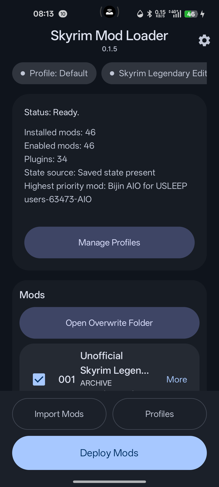
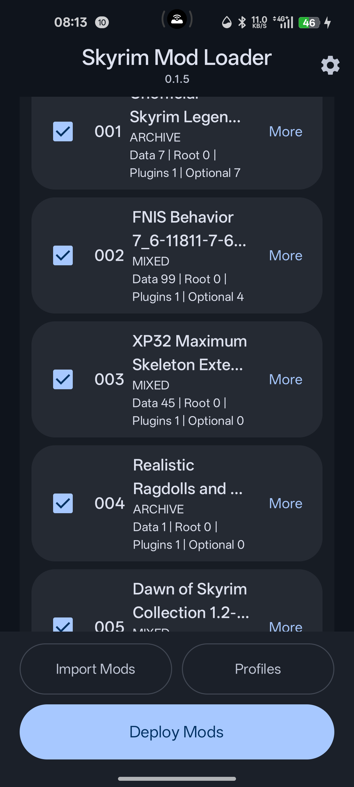

# Skyrim Mod Loader (Android)

An Android mod manager for Skyrim Legendary Edition on a static Skyrim LE Android port. A fork of [Droid Mod Loader](https://github.com/CyberShonk/DroidModLoader) (DML) by CyberShonk, adapted to the port's file layout and rebuilt around a Material You interface.



## What it does

- Imports `.zip`, `.7z` and RAR5 mod archives from the Android file picker, including FOMOD installers with option previews.
- Manages installed mods: enable or disable, reorder by priority, set a load position from `001` through the last mod, and delete.
- Editable ESP/ESM/ESL plugin list with enable/disable and Up/Down ordering. Locked official Skyrim masters stay pinned at the top.
- Detects the port folder at `<game root>/port` and writes `Plugins.txt` and `loadorder.txt` into it.
- Deploys the resolved mod setup to the game folder and reconciles plugins after installs, removals, toggles and deploys.
- Companion app: [LOOT Android](https://github.com/TweakerZ/loot-android) sorts plugin load order using the same `Plugins.txt` and `loadorder.txt`.



## Requirements

- Android 11 (API 30) or newer.
- All files access. SML reads and writes real game folders on shared storage.
- A Skyrim Legendary Edition static Android port that exposes its game folder on shared storage.

## Usage

1. Download `SkyrimModLoader-<version>.apk` from [Releases](https://github.com/TweakerZ/Skyrim-Mod-Loader/releases) and install it.
2. Choose your Skyrim main folder. SML validates it, finds the Data folder and detects the port folder when present.
3. Import mod archives, then enable and order your mods and plugins.
4. **Deploy Mods** copies the mod setup into the game folder. **Save ESP Order** writes `Plugins.txt` and `loadorder.txt`.

See the [User Guide](docs/user-guide.md) and [Troubleshooting](docs/troubleshooting.md) for details.

## Building

Requires JDK 17 and an Android SDK with build-tools 36.

```bash
./gradlew :app:assembleRelease
```

Release signing reads `keystore.properties` from the project root:

```properties
storeFile=/absolute/path/to/your.jks
storePassword=...
keyAlias=...
keyPassword=...
```

Without that file the release build is unsigned. The Compose components come from the shared `skyrim-suite-ui` sources checked out beside this repo (`../skyrim-suite-ui`).

## Layout

- `app/src/main/java/com/shonkware/droidmodloader/engine/` – archive import, installers, plugins, deployment and storage.
- `app/src/main/java/com/shonkware/droidmodloader/ui/` – Compose interface and workflow controllers.
- `app/src/main/java/com/shonkware/droidmodloader/ui/workflow/` – dashboards, installer and deployment workflows.
- `app/src/test/`, `app/src/androidTest/` – unit and instrumented tests.

## Credits

SML is a fork of [Droid Mod Loader](https://github.com/CyberShonk/DroidModLoader) by CyberShonk. It builds on Amethyst Mod Manager, the Nexus Mods FOMOD installer, Vortex, Mod Organizer 2, GameNative and Junrar, and targets the [Skyrim static Android port](https://github.com/ttom795/Skyrim_Android) by ttom795. See [CREDITS.md](CREDITS.md) for full credits and licence details.

This is an unofficial fan tool. Skyrim and its assets belong to Bethesda Softworks.

> [!NOTE]
> Yes, AI was used in building this.