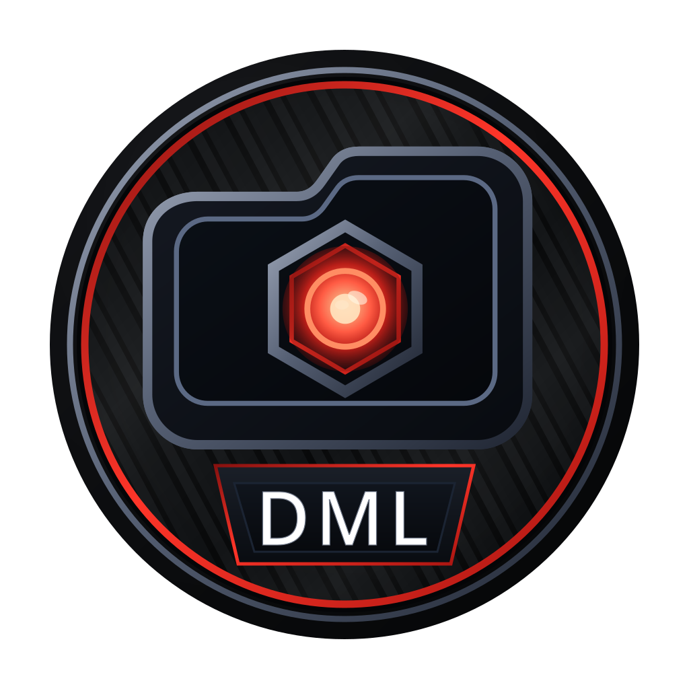

  

<h1 align="center">Skyrim Android Mod Loader</h1>

<strong>A Skyrim Legendary Edition fork of Droid Mod Loader for Android.</strong>

This fork targets a Skyrim Android static port. It keeps the proven DML
extraction, installer, plugin and deployment pipeline, but uses a Material You
single-page interface, the Android system multi-file picker, and a Skyrim
Legendary Edition plugin list that can be edited from the dashboard. Imported
archives are staged only long enough to extract them; no permanent zip copy is
kept.

Droid Mod Loader, or DML, manages Bethesda game mods for Windows compatibility
environments hosted on Android. It keeps installed mods separate, tracks profiles
and plugin state, and deploys a resolved mod setup to selected game folders.

> [!WARNING]
> DML is beta software that can write to game folders. Back up important game
> files before testing a new build or deployment setup.

## Current support

The current release is [v0.7.0-rc8](https://github.com/CyberShonk/DroidModLoader/releases/tag/v0.7.0-rc8).

This fork supports one game profile: **Skyrim Legendary Edition**.

Current capabilities include profiles, a Material You dashboard, Android system
multi-select archive import, managed mod installation, mod enable/disable and
priority, an editable ESP list with plugin enable/disable and ordering,
automatic Skyrim port folder detection, port `Plugins.txt` and `loadorder.txt`
synchronisation, deployment planning, physical deployment, diagnostics, and
recovery foundations.

DML uses direct filesystem paths and Android all files access for shared storage
workflows. Android 11 or newer is required.

DML installs supported ZIP, 7z, and single volume, unencrypted RAR5 archives,
including supported solid RAR5 archives. Password protected and multipart RAR
archives, and some uncommon compression or encryption variants, are unsupported.
See the [archive limits](docs/user-guide.md#current-limitations) before importing.

## New in v0.7.0-rc8

- Edit the ESP list from the dashboard: tick plugins on or off and move them up
  or down. Official Skyrim masters stay locked at the top.
- Choose **Save ESP Order** to write the pending changes to the port folder.
  `Plugins.txt` receives the enabled plugins and `loadorder.txt` receives the
  full order.
- The Skyrim port folder is detected automatically at `<game root>/port`. Its
  `save/AppData/Local/Skyrim` folder is read on startup and after profile or
  target changes, and written when ESP order is saved.
- Plugin installs, removals, mod enable/disable changes, normal deployment and
  full redeployment now reconcile the plugin list. Port plugin files are updated
  when the set of plugins changes, so removed ESPs no longer linger.
- The dashboard header shows the app name and version without the app icon.
- Launcher icons use the updated artwork with a white adaptive background and
  matching legacy and monochrome resources.

See the [release notes](releases/notes/v0.7.0-rc8.md) for changes and limitations.

## Compatibility environments

DML is intended for Android Windows compatibility setups that expose usable game
folders through shared storage. DML does not modify or depend on another
application's protected private storage.

Android may still block access to another application's protected `Android/data`
directory even when all files access is enabled.

## Get started

1. Download `DroidModLoader-v0.7.0-rc8.apk` from the [GitHub release](https://github.com/CyberShonk/DroidModLoader/releases/tag/v0.7.0-rc8).
2. Install the APK on your Android device. To update, install over the existing
   release app without uninstalling or clearing app data to retain profiles and
   state managed by DML.
3. Back up important game folders before deployment.
4. Follow the [User Guide](docs/user-guide.md). Choose your Skyrim main folder;
   DML checks it, finds the Data folder, and detects the port folder when present.
5. Use [Troubleshooting](docs/troubleshooting.md) if setup, import, plugin, or deployment behavior looks wrong.

## Project links

- [User Guide](docs/user-guide.md)
- [Troubleshooting](docs/troubleshooting.md)
- [Changelog](releases/changelog.md)
- [Credits](CREDITS.md)
- [Contributing](CONTRIBUTING.md)
- [ARM64Nexus community](https://discord.gg/RvTWcEeJ7Z)

## Credits

This project builds on work from the Droid Mod Loader community and the wider
modding ecosystem. See [CREDITS.md](CREDITS.md) for the projects that informed
or support this fork, including Droid Mod Loader, Amethyst Mod Manager, the Nexus
Mods FOMOD installer, Vortex, Mod Organizer 2, GameNative and Junrar.

## Contributing

Bug reports, compatibility notes, documentation corrections, reproducible test
cases, and focused code changes are welcome. See [CONTRIBUTING.md](CONTRIBUTING.md).

## License

Droid Mod Loader is released under the [MIT License](LICENSE).

## Disclaimer

Droid Mod Loader is an independent project. Users remain responsible for the
licenses and permissions of games, mods, and external tools they use.
